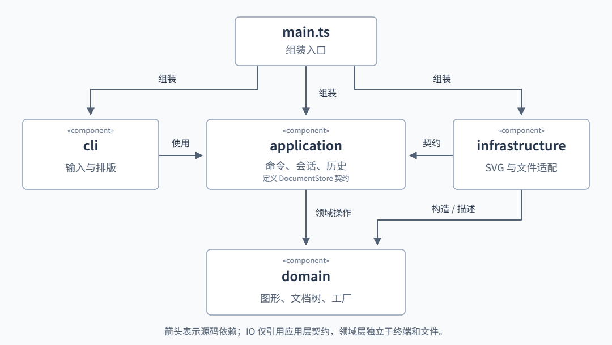

# 软件设计lab1：SVG CLI 编辑器

## 一、项目说明与运行

本项目完成 Lab1 Phase 1 的命令行 SVG 编辑器。采用 TypeScript 和面向对象设计，内置 `rect`、`circle`、`ellipse`、`line`、`text`、`g` 六种图形，支持编辑、结构查询、局部撤销重做及 SVG 文件读写。

当前已实现全部规定命令。`box`、动态插件系统、GUI 和其他 SVG 类型属于后续扩展范围。

### 1.1 环境与启动

本地确认的版本如下；这些是已使用的开发环境，不代表已经验证其他版本的兼容性。

| 项目 | 版本或配置 |
| --- | --- |
| Node.js | v24.14.0 |
| TypeScript | 7.0.2 |
| Node 类型定义 | @types/node 24.19.2 |
| XML 解析依赖 | @xmldom/xmldom 0.9.12 |
| 编译配置 | ES2022、NodeNext、strict；项目包使用 CommonJS |

在项目根目录的 CMD 中执行：

```cmd
npm install
npm run check
npm test
npm run cli
```

交互提示符为 `svg>`；按 Ctrl+C 结束程序。标准输入也可以用于脚本回放：

```cmd
node dist/main.js < commands.txt
```

脚本回放需先完成构建，脚本文件只包含命令，不写 `svg>` 提示符；空行和以 `#` 开头的整行注释会被忽略。双引号参数保留空格，颜色值中的 `#` 不会被当成注释。

### 1.2 命令

| 类别 | 语法 | 行为 |
| --- | --- | --- |
| 文档 | `init [w] [h]` | 新建画布，默认 800×600 |
| 文档 | `read <file.svg>` | 读取 SVG，缺 id 自动补全并输出警告 |
| 文档 | `save [file.svg]` | 保存到显式路径或当前关联路径 |
| 文档 | `canvas [w] [h]` | 查询或修改画布尺寸 |
| 编辑 | `create <type> <id> [params...] [in <containerId>]` | 创建图形并指定可选父容器 |
| 编辑 | `move <id> <dx> <dy>` | 增量移动，容器递归作用于子孙 |
| 编辑 | `scale <id> <factor>` | 同时缩放位置和尺寸，倍率必须为正 |
| 编辑 | `set <id> <attr> <value>` | 修改课程白名单内的属性 |
| 编辑 | `delete <id>` | 删除整个目标子树 |
| 编辑 | `group <newGid> <id1> [id2...]` | 收编已有图形，保留原树相对顺序 |
| 编辑 | `ungroup <gid>` | 解散非根级容器，将子节点原地提升 |
| 编辑 | `addto <gid> <id>` | 将已有子树移入指定容器末尾 |
| 编辑 | `front <id>` / `back <id>` | 移到同级绘制顺序末尾 / 开头 |
| 查询 | `tree [id]` | 显示全文档或指定子树及关键属性 |
| 查询 | `show <id>` | 显示属性和父容器明细 |
| 查询 | `help` | 显示全部命令与语法 |
| 历史 | `undo` / `redo` | 撤销 / 重做一条成功编辑 |


## 二、架构方案

### 2.1 模块划分与依赖

| 模块 | 职责 |
| --- | --- |
| `cli` | 解析输入、逐条执行、排版结果与错误 |
| `application` | 命令分发、会话、撤销重做、查询与存储契约 |
| `domain` | 图形几何与样式、容器行为、文档树及图形工厂 |
| `infrastructure` | SVG 解析、序列化与文件读写 |
| `main.ts` | 组装对象，将存储实现注入应用 |



箭头表示源码依赖。`cli → application → domain` 将输入、用例与图形规则分开；`infrastructure → application` 仅引用存储契约，应用通过接口调用 IO。领域层不依赖终端、文件或 XML 库，这些规则也适用于 `import type`。


### 2.2 需求—设计模式—实现

| 需求 | 设计模式 | 实现 |
| --- | --- | --- |
| 统一执行命令，一条编辑对应一次撤销重做 | Command | `Command` 定义执行接口，`EditCommand` 增加 undo/redo；各命令保存局部恢复记录，`CommandHistory` 统一管理历史 |
| 叶子与容器使用相同操作接口 | Composite | `Shape` 定义统一行为，`GroupShape` 递归执行 move/scale；组的 set 修改自身样式，删除共用文档的子树移除入口 |
| CLI 创建和 SVG 读取共用类型与构造规则 | 简单工厂 | `ShapeFactory` 集中六种类型的参数、几何字段与构造回调，读取模块不再按标签分派 |
| 文件或 XML 实现变化时，应用用例保持独立 | 依赖倒置（设计原则） | `DocumentStore` 在应用层定义，`SvgFileStore` 实现，`main.ts` 注入具体实现 |

撤销仅保存受影响的几何、属性或结构，直接恢复保存值；`SvgDocument` 维护唯一 id、父子关系、无环及顺序，完整校验后才修改，成功后才更新历史。

简单工厂未实现 GoF Factory Method 或插件加载。`CommandDispatcher` 的命令名分发和 `ShapeFactory` 的类型表是课程允许的两处集中分派，均标为待重构。

### 2.3 变化点假设

| 可能变化 | 当前安排与边界 |
| --- | --- |
| 新增命令或图形 | 统一 Command/Shape 契约；需扩展集中分发或工厂，暂不实现动态注册 |
| 新增 GUI 或脚本入口 | application 不依赖终端，可复用现有用例 |
| 更换存储或 XML 工具 | 通过 DocumentStore 替换适配器，仍需验证格式语义 |
| 扩大 SVG 范围或处理大文档 | 读取集中于适配层，历史采用局部恢复；独立变换模型与性能优化按实际需求补充 |

## 三、过程记录

### 3.1 协作与主要决策

开发先完成项目约束、环境配置、GitHub 仓库准备和架构讨论，再进入业务实现。作者负责需求判断、代码审查、课程文档和 Git 提交，AI 负责架构建议、增量实现和必要检查。

下表依据已有关键对话与实际实现记录整理，不作为逐字对话转录。详细记录见 `conservation.md`

| 问题或讨论 | 作者的判断与处理 | 实现结果 |
| --- | --- | --- |
| AI 最初把进度记录放在 doc 中 | 明确 doc 仅由作者编辑，要求 AI 记录统一放入新目录 | 改为 ai-notes；课程报告由作者审查整理 |
| TypeScript 知识讲解的起点 | 作者指出已有编程基础，只是未使用过 TypeScript | 讨论聚焦语言特性、接口与架构中的模式选择 |
| 撤销使用全量快照还是局部恢复 | 作者明确选择局部恢复，并要求理解树不变量 | 各命令保存局部状态，文档负责结构一致性 |
| IO 后的历史如何处理 | 确认成功 init/read/save/canvas 修改后清空双栈并禁止撤销；canvas 查询保持历史 | 成功编辑重新解禁；失败保留文档与历史 |
| 跨父容器分组的位置和顺序 | 确认新组放在最近公共祖先末尾，成员按原树遍历顺序排列 | 保存受影响子列表，撤销恢复原归属和顺序 |
| 组的样式是否覆盖所有子图形 | 选择 SVG 继承语义，保留子图形显式样式 | set 修改组自身属性，换父或解组可能改变继承效果 |
| 无参数 save 的路径 | 确认成功 read 或显式 save 后建立关联，init 清除关联 | 保存失败不改关联，成功后才更新路径和历史 |
| 一个架构文档内容过多 | 作者要求保留总览并按模块拆分 | 总览、模块职责、实施记录分别维护，再汇总成报告 |
| 外部 SVG 的处理范围 | 确认保留 font-size/text-anchor，不支持内容明确报错 | 使用 XML 解析器；这些展示属性只读保留，不扩大 set 白名单 |

分组可能改变组内外遮挡关系和样式继承，因此这里的“保持相对顺序”指被收编成员之间的顺序，不承诺跨容器的全部视觉关系不变。

### 3.2 分步实现与修正

代码先建立 CLI 和画布，再实现图形模型与受控树，然后接入历史和编辑，最后实现显示与 IO。每一批完成检查后供作者审查，后续 Git 提交由作者执行。

| 本地提交 | 主要内容 |
| --- | --- |
| 24f9a2c、4cedd59 | CLI 基础、命令解析、init/canvas |
| 0672225、cbc0836、e3c0efb | 图形抽象、容器、受控树、六种类型与工厂 |
| bae0e7d | create/move 与 undo/redo |
| d670991、a6cea72 | scale/delete 与属性修改 |
| 66f05c5、c01e374 | 换父、层次调整、分组与解组 |
| 8bc1568 | tree/show 与 SVG 保存 |
| 356a311 | SVG 读取、缺 id 补全、保存读回 |


## 四、一致性自查

### 4.1 模块划分

实际目录与四模块方案一致，组装入口为 `main.ts`，验证代码位于 `tests/`。命令类位于 `application/commands/`，对外契约位于 `application/contracts/`，内部树写入凭据位于 `domain/internal/`，均属于原模块内部细分。

实现中增加 `PlacementCommand` 共享三个换位命令的历史流程，增加 `GroupingChange` 保存分组相关局部子列表；这些调整没有改变模块边界，已在模块说明和实施记录中注明。

初始方案允许 main 为组装直接使用 domain，但当前工厂由分发器和读取适配器使用，main 没有直接 import domain。本报告的组件图按实际源码绘制。

### 4.2 依赖方向

当前源码抽样检查如下：

| 检查对象 | 实际依赖 | 结论 |
| --- | --- | --- |
| CliApplication | application 命令入口、cli 对象、终端 API | 符合规则 |
| EditorSession | domain 文档、application 历史与存储契约 | 符合规则，没有 import SvgFileStore |
| SvgFileStore | 存储契约、domain 文档、infrastructure 适配器、文件 API | 符合规则 |
| SvgReader | 读取契约、domain 文档和工厂、xmldom | 符合规则 |
| Shape | domain 内部的描述、恢复记录和树写入凭据 | 符合规则 |
| main | cli、application、infrastructure 公开入口 | 符合组装职责 |

此次抽样未发现违反依赖方向的引用。图形标签分派仍集中在 ShapeFactory，命令名分派仍集中在 CommandDispatcher；两处按课程要求标为待重构，并未声称已经完成插件化。

## 4.3 质量保证手段

### 已执行的验证

最近一次实现验证通过 TypeScript 类型检查、构建及全部 **150 项 Node.js 内置测试**，0 失败、0 跳过。`npm test` 内部已执行构建；报告整理阶段未为文档变更重复运行代码测试。

同时，每次agent提交代码后都由人工review过关键代码

| 验证类别 | 覆盖内容 |
| --- | --- |
| 输入与 CLI | 双引号、空文本、颜色值、整行注释、错误后继续运行、EOF、顺序等待异步 IO |
| 几何与样式 | 六种类型、位置和尺寸缩放、嵌套组、有限数值校验、溢出失败、样式省略 |
| 树结构 | 全局 id、父子一致性、子树归属、循环拒绝、同级顺序、根级解组限制 |
| 历史 | 单命令粒度、混合编辑、浮点值精确恢复、缺失属性恢复、原对象身份 |
| 失败原子性 | 非法操作保留文档、顺序和 redo；undo/redo 恢复失败后可重试 |
| IO 历史与路径 | 成功后双栈清空及限制、成功编辑解禁、默认路径、失败保留关联 |
| SVG 读写 | 六种原生元素、命名空间、缺 id 避让、UTF-8、文本实体和 CDATA、保存读回 |
| 实际文件与会话 | 带空格路径、临时文件保存、失败保护原文件、作业典型会话及导入部分 |

静态类型用于约束接口，运行时校验用于保证数值、id 与树结构规则。文件首行说明用途，关键恢复和原子性逻辑使用中文注释，类按文件拆分，方便人工审查。

这些结果证明已覆盖的行为通过验证，不代表任意外部 SVG 或所有极端输入都已穷尽测试。

